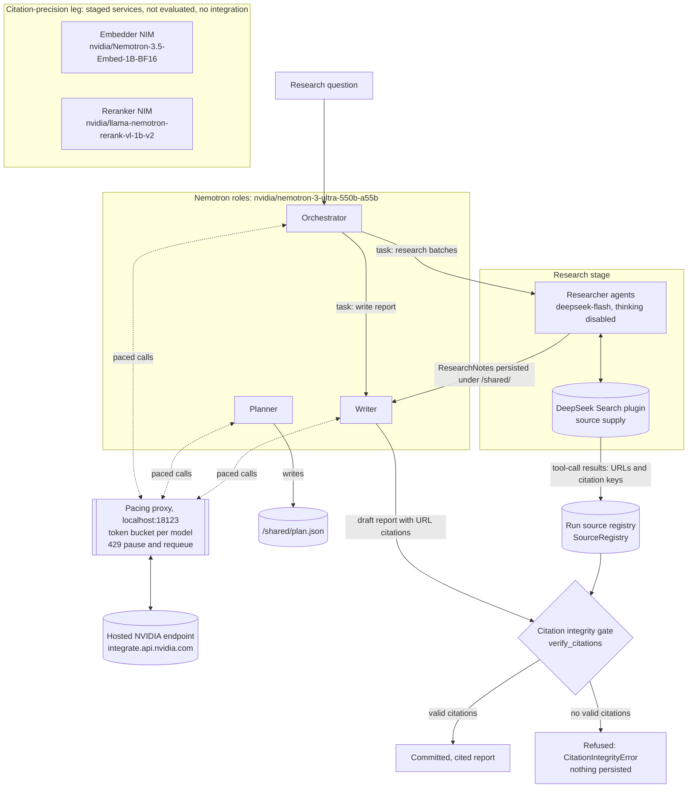

# Architecture

An AI deep research funnel built on the NVIDIA AI-Q blueprint pattern, with a citation integrity gate at the exit. Only edges confirmed by the run record and the pulled code are drawn.

The two staged NIM services are drawn without edges on purpose. There is no integration code for them in the evaluated configuration.

## Model IDs

| Role | Model ID | Reached through |
|---|---|---|
| Orchestrator, planner, writer | `nvidia/nemotron-3-ultra-550b-a55b` | the pacing proxy (localhost:18123) to integrate.api.nvidia.com, on the OpenAI-compatible client with `request_timeout: 600` |
| Researchers | `deepseek-flash`, thinking disabled (`reasoning_effort: none`) | the DeepSeek API |
| Source supply | DeepSeek Search, through the locally built plugin `aiq/sources/deepseek_web_search` | the DeepSeek API |
| Staged embedder (not evaluated) | `nvidia/Nemotron-3.5-Embed-1B-BF16` | local NIM service |
| Staged reranker (not evaluated) | `nvidia/llama-nemotron-rerank-vl-1b-v2` | local NIM service |

## Component walk-through

**Nemotron roles.** The orchestrator, planner and writer all run `nvidia/nemotron-3-ultra-550b-a55b` on hosted NVIDIA endpoints, and every call goes through the pacing proxy. The planner writes the research plan to the job's shared state (`/shared/plan.json`). The orchestrator delegates research batches to researcher subagents and the final report to the writer subagent. Researchers' `ResearchNotes` are persisted under `/shared/`, where the writer reads them; the writer must commit the final report to `/shared/output.md` with URL citations.

**Pacing proxy.** NVIDIA enforces a short per-minute burst cap. Without pacing, two earlier Q01 attempts failed with 46 and 90 HTTP 429 responses. The proxy keeps a token bucket for each model plus a global bucket, pauses a model's bucket for 60 s after an upstream 429, and requeues the request, so a rejection becomes extra latency. In the final run it absorbed 125 upstream 429s, and none reached the funnel as a failure. The Nemotron client uses `request_timeout` 600. That setting fixed a collision between the old nim client's 60-second read limit and the proxy's 60-second 429 pauses during long non-streamed generations.

**Researcher agents.** `deepseek-flash` does the research, with thinking disabled on researcher calls (the fix for thinking-mode `tool_choice` 400 errors). Its output stops at 8,192 tokens per note even though the config asks for 32,768. Tavily is not used in the final configuration.

**DeepSeek Search plugin.** A locally built AI-Q search provider with the same tool contract and tool names as the shipped providers. Every result it emits is stamped `provenance="deepseek-search"` and carries `rerank_score` and `authority` values.

**Run source registry.** `SourceRegistry` in `citation_verification.py` captures URLs and citation keys from tool-call results during the run. It is the reference the gate checks citations against.

**Citation integrity gate.** `agent.py` verifies citations twice: once in post-processing, where invalid citations are removed, and again on the final message. If the final verification has no valid citations, it raises `CitationIntegrityError` (`citation_integrity_lost`) and nothing is published. In the final evaluation it caught Q06, a report that matched zero sources in the registry. See [GATE.md](GATE.md).

**Execution budget.** `agent.py` wraps the orchestrator invocation in a 3,600 s server-side graph budget (`resource_limits.py`). When it expires, the job fails with `DeepResearchExecutionTimeout`. This is what ended Q08. See [PASS-RULES.md](PASS-RULES.md).

**Citation-precision leg (staged).** These services target the weak metric, citation precision. The embedder (`nvidia/Nemotron-3.5-Embed-1B-BF16`; BF16 is the weights artifact, fp16 the serving precision) and the reranker (`nvidia/llama-nemotron-rerank-vl-1b-v2`, FP16, GB10-optimized) are staged as local NIM services. Both were verified live on 2026-10-25 and answered again before the recorded run on 2026-10-26. They are not part of the evaluated pipeline, and the published results do not include them.

**Platform.** It runs on a Windows on ARM laptop (Lenovo Yoga, NVIDIA RTX Spark). The mix of hosted and local components is forced by the platform: components that needed DGX OS or x86 Linux were excluded on vendor evidence. See [KNOWN-LIMITS.md](KNOWN-LIMITS.md).
